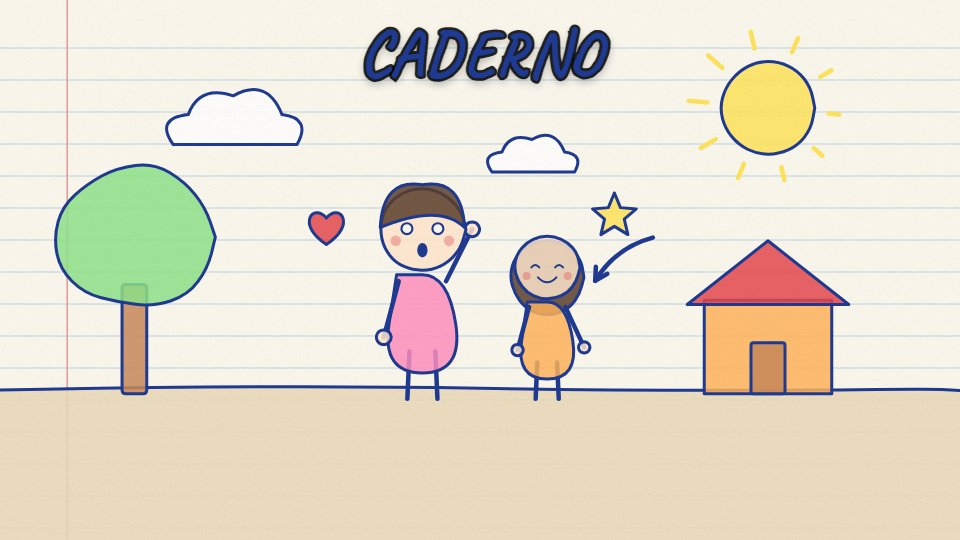
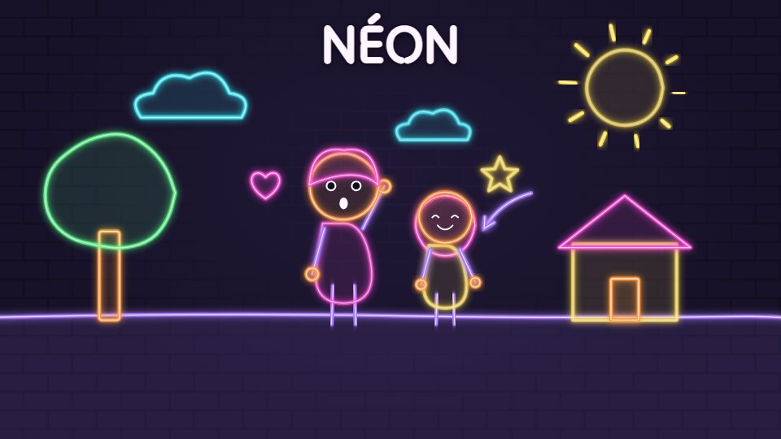
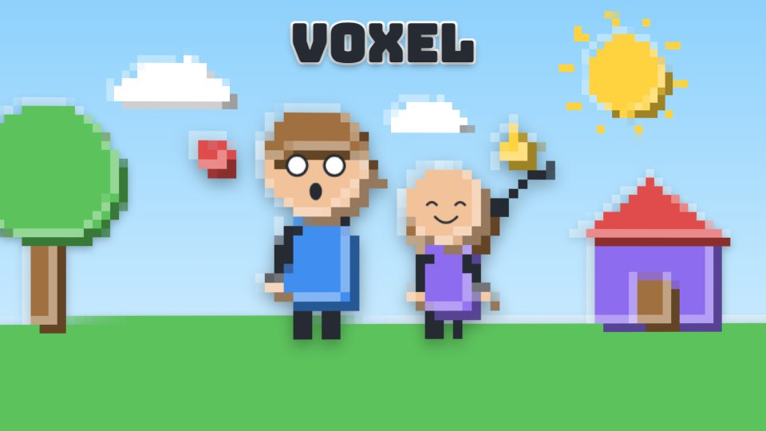

# 🎬 Scene Factory Free

**Turn Claude Code into an animation studio.** You tell it the idea and it delivers the finished animated video:
a script with a hook, drawn and animated scenes, word-by-word captions and, if you want, your own voice. No drawing
skills and no editing software needed.

| Notebook (2D) | Neon (2D) | Voxel (light 3D) |
|---|---|---|
|  |  |  |

## What you need

- Claude on a **paid plan** (Pro is enough): it runs inside Claude Code.
- The **Claude desktop app** (Windows or Mac): [claude.ai/download](https://claude.ai/download).

## How to use it (5 minutes)

1. Download this folder: green **Code → Download ZIP** button, then unzip it.
2. Open the folder in the Claude desktop app, in the **Code** tab.
3. Send: `Claude, set up the Scene Factory following the START-HERE.md file in this folder.`
4. Ask for your video, your way:
   *"Make a 40-second video in the Neon style with 5 fun facts about space."*

The video comes out as an MP4, vertical (Reels, Shorts, TikTok) or horizontal (YouTube), in the `finished-videos` folder.

## Want more? Check out the full version

| | Free | Full |
|---|:---:|:---:|
| Animation styles | 3 | **28** |
| Full 3D in Blender | — | ✓ |
| Use it from your phone | — | ✓ |
| Library with a ready prompt for every style | — | ✓ |
| ElevenLabs voice guide | — | ✓ |
| WhatsApp support | — | ✓ |

👉 **[https://scenefactory.netlify.app/](https://scenefactory.netlify.app/)**

---
Scene Factory is an independent product and is not affiliated with Anthropic. Claude is a trademark of Anthropic.
